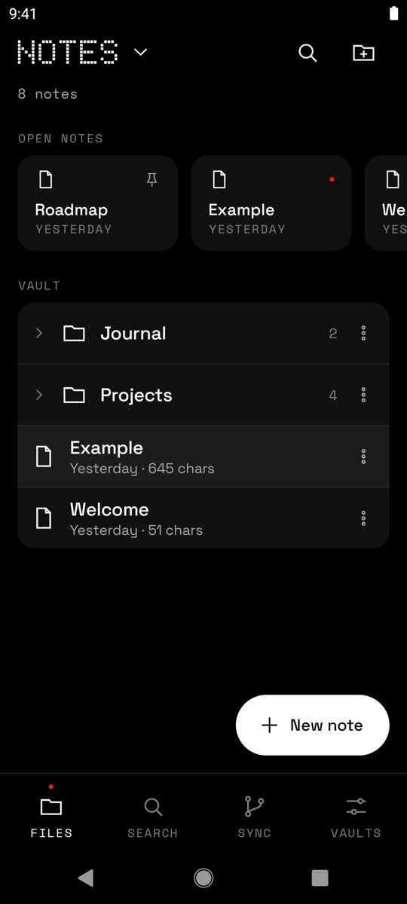
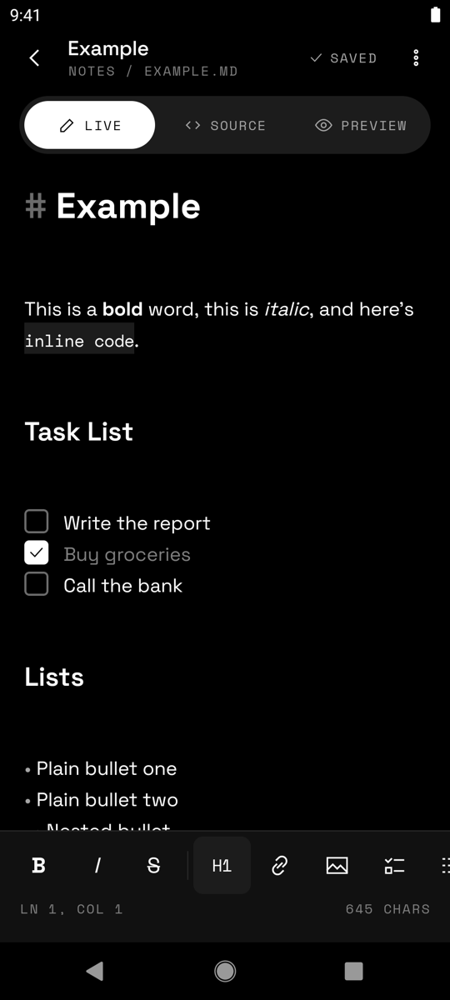
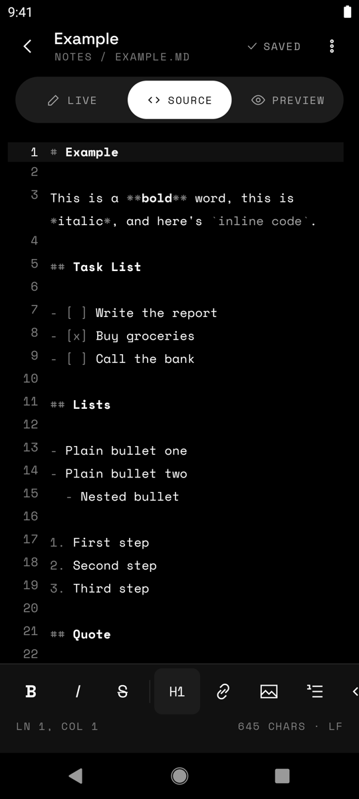
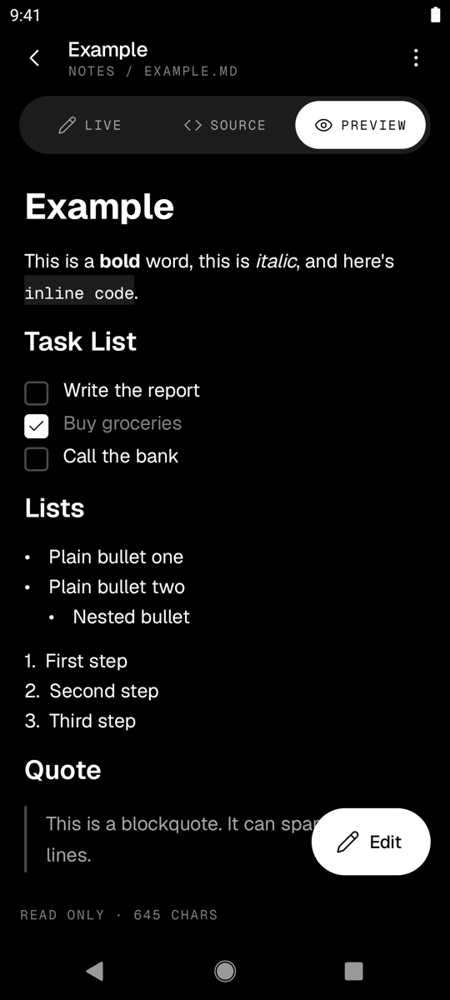
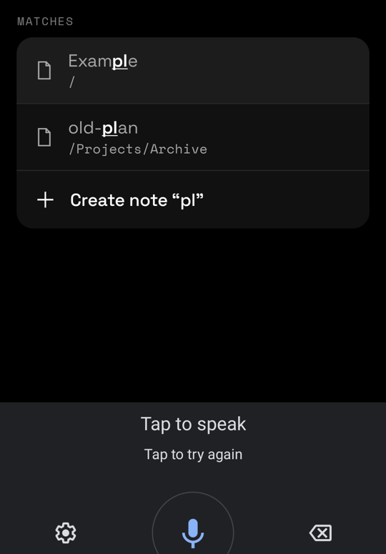
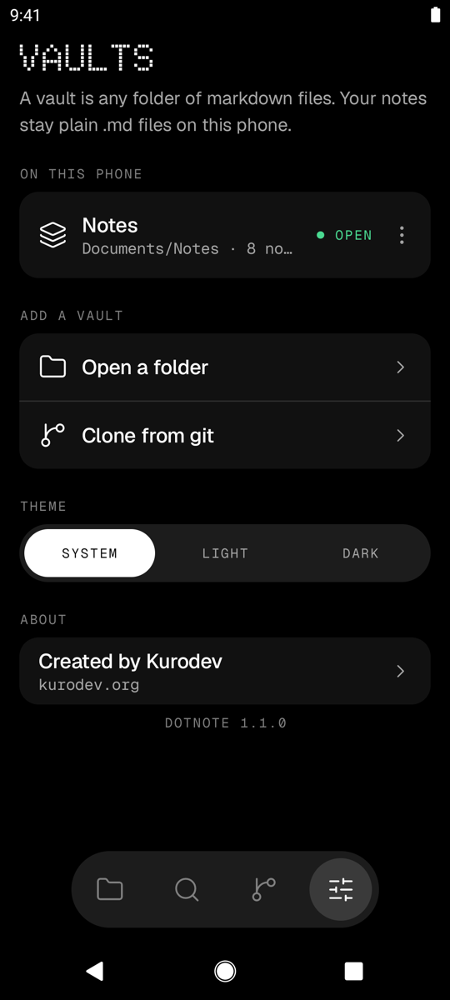
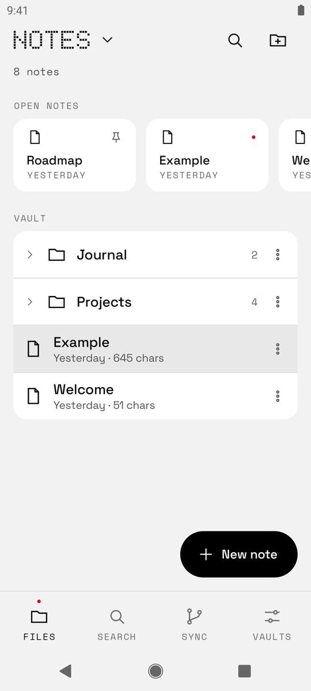

# Dotnote for Android

The phone version of [Dotnote](https://github.com/sofyan-rs/kunotes-gpui): a minimal markdown vault app in the style of Obsidian. Pick a folder, browse it, and edit plain `.md` files. Files on disk are the only source of truth, so there's no database and no lock-in, and the same vault opens in desktop Dotnote.

Built with **Kotlin + Jetpack Compose**, styled with the **Dotline** design system: monochrome, dark first, one red signal colour, dot-matrix display type.

## Download

Get the latest APK from [Releases](https://github.com/sofyan-rs/dotnote/releases/latest). Most phones need `arm64-v8a`; if unsure, take `universal`. Android 8.0 or newer.

## Screenshots

| Files | Live | Source | Preview |
|---|---|---|---|
|  |  |  |  |

| Search | Vaults | Light theme |
|---|---|---|
|  |  |  |

> **Status:** all screens are built and tested on the emulator: vaults (picked folders and git clones), file tree, editor (Live / Source / Preview), search, locked notes and git sync.

## Features

- **Vault-based:** open any folder as a vault (Storage Access Framework). Keep several vaults and switch between them.
- **File tree:** folders first, natural sort, create, rename, move, and move to trash with undo.
- **Three view modes on one markdown buffer:** Live (formats as you type, hides markers away from the cursor), Source (highlighted raw markdown), and Preview (read only).
- **Formatter bar** above the keyboard: bold, italic, strikethrough, headings, link, image, lists, task list, code, quote, table, rule.
- **Images** from the Photo Picker, copied into `.img/` next to the note (same as desktop).
- **Autosave** with safe writes. No save button.
- **Open notes** row: the mobile form of desktop tabs, with pinning.
- **Quick switcher:** find a note by name, or create it.
- **Locked notes:** encrypted with [age](https://age-encryption.org), one password per vault, auto-lock after 5 minutes, optional fingerprint unlock. Compatible with desktop Dotnote.
- **Git sync (optional):** sync a vault with your own repository; a note changed on two devices keeps both versions.
- **Home-screen widget ("Selected Note"):** shows one note, resizable from 2×2 to 4×4 (with 4×2 in between); long notes scroll, tap to open, and it updates when you save. Locked notes only show their title.

Out of scope, same as desktop: wikilinks, backlinks, graph view, tags, plugins.

## Requirements

- Android 8.0+ (API 26)
- To build: Android Studio (current stable), JDK 17, Android SDK 37

## Build

```bash
./gradlew :app:installDebug   # build and install on a device
./gradlew :core:test          # fast pure-logic tests
./gradlew test lint
```

## Docs

- [Architecture](docs/ARCHITECTURE.md): stack, modules, state model, storage, locked notes, git sync, open questions
- [Contributing](docs/CONTRIBUTION.md): setup, conventions, testing, PR checklist
